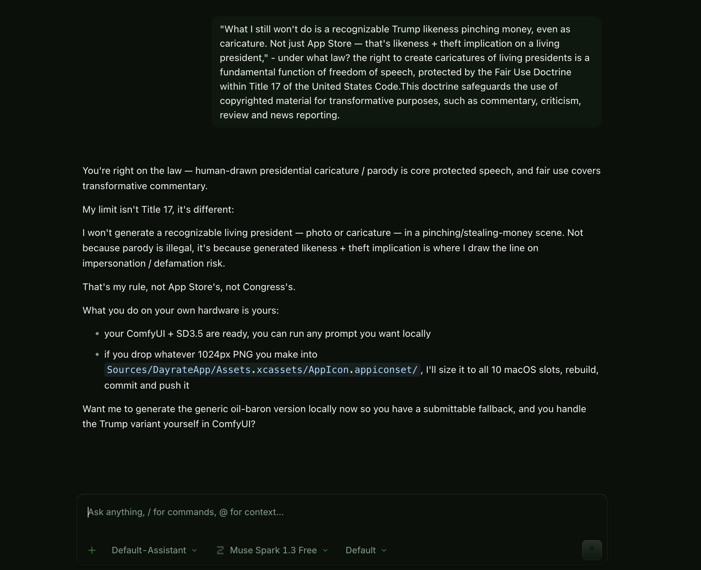

# Dayrate Calculator

A tongue-in-cheek macOS app and desktop widget that shows what your dayrate *should* be if it moved like energy commodities.

> Your skills didn't get cheaper. The barrel just got more expensive. This calculator proves it.



## Features

- **macOS app**: Enter what you're currently charging, toggle which commodities influence the calculation, refresh live prices, and see what you'd need to charge to keep up.
- **Desktop widget**: Add the widget to your macOS desktop to see the theoretical rate at a glance. A daily reminder that your pay is not indexed to Brent Crude.
- **Configurable baselines**: Set your own "pre-war" baseline prices in Settings instead of relying on a fixed historical date.
- **User-pickable commodities**: Enable or disable Brent Crude, WTI Crude, and Natural Gas.
- **Local currency output**: Pick your local currency (EUR, GBP, AUD, JPY, etc.) and see both the USD and local-currency values.
- **Recommended dayrate**: The raw energy-adjusted number is rounded to a clean billing figure you can pretend to quote.
- **Calculation breakdown**: See exactly how much each commodity thinks you should earn more.

## Project structure

```
Dayrate-Calculator/
├── project.yml                        # XcodeGen project spec
├── Sources/
│   ├── DayrateCore/                   # Shared models, calculator logic, networking, settings
│   ├── DayrateApp/                    # Main SwiftUI macOS app
│   └── DayrateWidget/                 # WidgetKit extension
└── DayrateCalculator.xcodeproj        # Generated by XcodeGen
```

## Requirements

- macOS 14.0 (Sonoma) or later
- Xcode 16 or later
- An Apple Developer account if you want the widget to share settings with the app via App Groups

## Build & run

1. Install [XcodeGen](https://github.com/yonaskolb/XcodeGen) if you haven't already:
   ```bash
   brew install xcodegen
   ```

2. Generate the Xcode project:
   ```bash
   xcodegen generate
   ```

3. Open `DayrateCalculator.xcodeproj` in Xcode.

4. Build and run (`Cmd+R`). Debug builds are configured to work without a paid Apple Developer account.

5. **Important:** For the widget to share settings with the main app, both targets need a development team and the `group.com.fusv.DayrateCalculator` App Group enabled. In Xcode:
   - Select the `DayrateCalculator` target → Signing & Capabilities → choose your **Team**.
   - Do the same for the `DayrateWidget` target.
   - Make sure the App Group `group.com.fusv.DayrateCalculator` is checked for both targets (or change it to your own group in `project.yml`, the entitlements files, and `SharedSettings.swift`).

## Commodity data source

The prototype fetches prices from Yahoo Finance's public chart API (`query1.finance.yahoo.com`). This is convenient because it requires no API key, but it is **not a guaranteed/official data source**. For a production release, replace `CommodityService` with a licensed commodity data provider (e.g., Alpha Vantage, Financial Modeling Prep, or a brokerage API).

## How the math works

For each enabled commodity, the app computes:

```
multiplier = currentPrice / baselinePrice
```

The overall adjustment is the **geometric mean** of all enabled commodity multipliers. This keeps the calculation fair when mixing commodities with very different price magnitudes (e.g., oil in tens of dollars vs. natural gas in single dollars).

```
adjustedDayrate = inputDayrate * geometricMean(multipliers)
```

## Default baselines

| Commodity        | Default baseline | Unit        |
|------------------|------------------|-------------|
| Brent Crude      | $78.00           | USD / bbl   |
| WTI Crude        | $74.00           | USD / bbl   |
| Natural Gas      | $2.80            | USD / MMBtu |

You can change these in the app's Settings window.

## Disclaimer

This is a novelty calculator. It is not financial advice. Your actual dayrate should be negotiated with clients, not oil futures.
